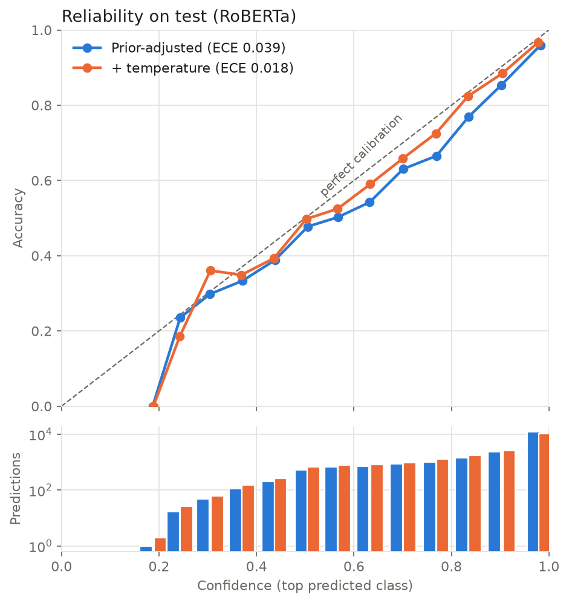

# Complaint Triage

Classifies US consumer finance complaints by product, with confidence scores calibrated well enough to decide which complaints can be routed automatically and which need a person. Built on 3.85M complaint narratives from the CFPB Consumer Complaint Database.

- **Test macro-F1 0.753** with fine-tuned RoBERTa, against 0.724 for a TF-IDF baseline (+2.9 points, 95% CI [+1.8, +4.0])
- **Calibrated confidence:** expected calibration error 0.018 after temperature scaling
- **Routing:** sending complaints below 0.80 confidence to a person reviews 25% of complaints, catches 68% of the model's errors, and leaves the rest 93.7% accurate

## Problem

The consumer picks a product when filing a complaint, and the text often fits a different one. A classifier that reads the narrative can route complaints to the right team, but only if it also knows when it is unsure.

## Data

Source: the CFPB bulk complaints export (18.4M complaints, December 2011 to October 2026) and the narrative exports, which hold the complaint text for the 3.85M complaints where the consumer agreed to publish it. Both are loaded into Postgres by `scripts/build_db.sh`.

| Step | Where | Complaints |
|---|---|---|
| Complaints with a narrative | `sql/05_complaints_text.sql` | 3,851,396 |
| Remove exact duplicate narratives, keeping the earliest | `sql/06_model_data.sql` | −1,254,759 |
| Remove narratives under 10 words | `sql/06_model_data.sql` | −13,376 |
| **Modelling data** | | **2,583,261** |

- **Labels:** the CFPB's 21 product names, which changed over the years, are mapped to 10 groups (`sql/05_complaints_text.sql`).
- **Time-based split:** train before 2024 (1.39M), validation 2024 (470k), test 2025 to August 2026 (726k). Duplicates are removed across the whole dataset before splitting, so no text appears in two splits.
- **Samples** (`scripts/export.py`): up to 15,000 training complaints per class (135,592 in total; "Other" has only 592), and 20,000 random complaints each for validation and test.

The training sample is balanced, but real complaints are not: credit reporting is 67% of validation and 51% of test.

## Approach

1. **Baseline:** TF-IDF on word unigrams and bigrams, with class-balanced logistic regression.
2. **RoBERTa-base**, fine-tuned for 2 epochs with texts cut off at 512 tokens (`configs/roberta_512.yaml`, trained on a Colab A100 in `notebooks/03_roberta.ipynb`).
3. **Prior adjustment:** the models train on balanced classes, so their scores are corrected towards the real class mix by adding τ · log(p_val / p_train) to each class score. τ is chosen on validation, then applied once to test.
4. **Temperature scaling:** the adjusted scores are divided by one number T, fitted on validation to minimise log loss. It changes confidence only, never the predicted class.

## Results

| Model | Val macro-F1 (raw) | Val macro-F1 (prior-adjusted) | Test macro-F1 |
|---|---|---|---|
| TF-IDF + logistic regression | 0.671 | 0.710 (τ = 0.5) | 0.724 [0.711, 0.737] |
| RoBERTa-base, 512 tokens, 2 epochs | 0.691 | 0.738 (τ = 0.75) | **0.753** [0.740, 0.766] |

Brackets are 95% confidence intervals from a paired bootstrap over test complaints (2,000 resamples, `scripts/bootstrap_script.py`). RoBERTa's gain is +2.9 points [+1.8, +4.0], and it scores below the baseline in none of the resamples.

On test, RoBERTa beats the baseline on all ten classes (accuracy 0.850 vs 0.838). The largest gains are on the hardest classes: personal/payday loans (F1 0.58 → 0.66) and "Other" (0.28 → 0.36). Credit reporting (0.91) and mortgage (0.90) are easiest to classify.

## Calibration and routing

For triage, the model's confidence has to be trustworthy: a stated confidence of 90% should mean it is right about 90% of the time.

| RoBERTa on test | ECE | Log loss | Macro-F1 |
|---|---|---|---|
| Raw | 0.036 | 0.522 | 0.729 |
| Prior-adjusted (τ = 0.75) | 0.039 | 0.461 | 0.753 |
| Prior-adjusted + temperature (T = 1.13) | **0.018** | **0.451** | 0.753 |

ECE is expected calibration error over 15 equal-width confidence bins. The prior adjustment mainly improves log loss by correcting class frequencies. Temperature scaling halves ECE: T > 1 means the fine-tuned model was overconfident.



Points below the diagonal are overconfident. The lower panel shows how many predictions fall in each bin; about half are above 0.93 confidence, where the calibrated model is close to the diagonal.

**Routing.** Complaints below a confidence threshold go to a person; the rest are routed automatically. The threshold was chosen on validation as the lowest one giving at least 95% accuracy on the auto-routed complaints:

| Threshold 0.80 | Sent to a person | Auto-routed accuracy | Errors caught |
|---|---|---|---|
| Validation (chosen here) | 19.3% | 95.1% | 65% |
| Test (reported once) | 25.1% | 93.7% | 68% |

Reviewing the least confident quarter of complaints catches two-thirds of the errors; reviewing a random quarter would catch a quarter. "Other" (69% reviewed) and personal/payday loans (51%) go to a person most often.

## Limitations

- **"Other" is weak** (F1 0.36, recall 0.23). It has only 592 training examples and covers a mixed set of products.
- **Labels are noisy.** They are the product the consumer selected, which does not always match the narrative.
- **Drift.** Test complaints (2025–26) are further from the training data than validation (2024), and the routing threshold sends 25% to a person on test against 19% on validation. The class mix also shifts between years, so the prior adjustment needs updating as it changes.
- **Truncation at 512 tokens** affects 14% of test complaints, but accuracy on them is higher (89.1%) than on shorter ones (84.4%), so it costs little.
- **Exact duplicates only.** Near-duplicate template letters remain and may make some classes look easier than they are.
- **τ from a noisy estimate.** Choosing τ on half of validation gave 0.25, against 0.75 on all of it; the rare classes make that estimate unstable.

## Status

Done: data pipeline, baseline, fine-tuned classifier, calibration and routing. Next: an inference API and deployment, then discovering emerging issues in the complaints over time and turning the findings into recommendations.

## Repo layout

```
sql/          Postgres pipeline, run in order by scripts/build_db.sh
scripts/      database build, sample export, bootstrap test
src/complaint/
  config.py       run settings (YAML) and DATA_DIR
  data.py         loading splits and tokenising
  train.py        fine-tuning, τ sweep, temperature fitting
  evaluation.py   metrics and prior adjustment
  calibration.py  ECE, temperature scaling, routing table
  bootstrap.py    paired bootstrap
configs/      roberta_512.yaml (reported run), smoke.yaml (quick check)
notebooks/    01 EDA, 02 baseline, 03 RoBERTa (Colab), 04 calibration
figures/      figures used in this README
```

## Reproduce

Needs Python 3.13, [uv](https://docs.astral.sh/uv/) and Postgres with a `complaints` database. Put `DATABASE_URL` (`postgresql+psycopg://...`) and optionally `DATA_DIR` (default `data/`) in `.env`.

```bash
uv sync --all-extras                 # or --extra train / db / serve
scripts/download_narratives.sh       # narrative exports; complaints.csv goes in data/
scripts/build_db.sh                  # Postgres pipeline
uv run python scripts/export.py      # train/val/test parquet files into DATA_DIR
uv run python -m complaint.train --config configs/roberta_512.yaml   # needs a GPU
uv run python scripts/bootstrap_script.py   # needs data/preds_test.parquet
```

`bootstrap_script.py` compares against RoBERTa's test predictions, which the "Test set" cell of `notebooks/03_roberta.ipynb` saves; copy `preds_test.parquet` into `data/`.

To check the pipeline quickly on CPU, run training with `configs/smoke.yaml` instead.
